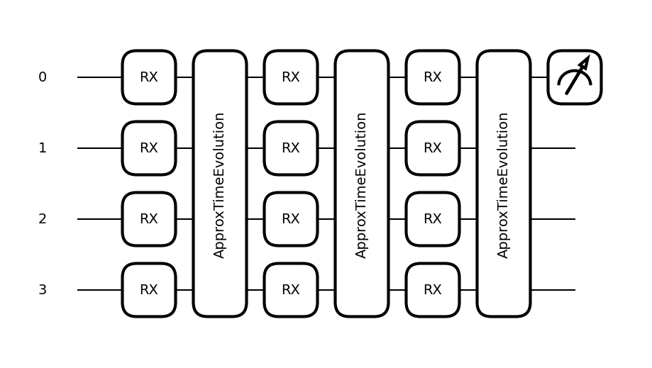
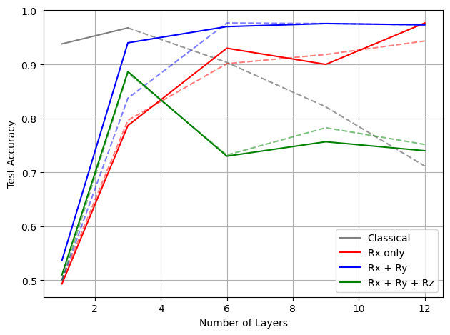
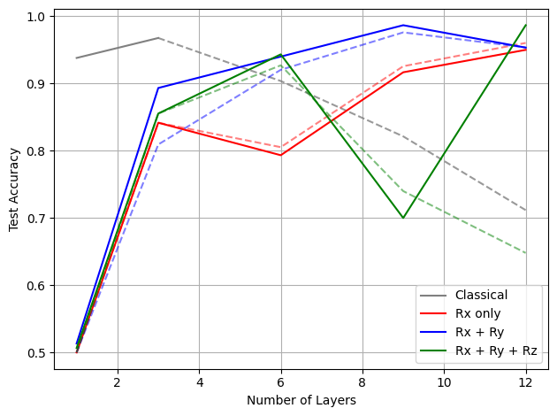

# Learning graph connectivity with permutation-equivariant quantum circuits

## 1. Introduction

In this project we use a quantum machine learning model to learn a permutation-invariant property of graphs: connectivity. A graph is labelled connected or disconnected, and relabelling its vertices does not change that label. Our model is a data re-uploading circuit. Each layer encodes the graph through its Ising Hamiltonian $H_G = \sum_{(i,j)\in\epsilon} \sigma_z^i \sigma_z^j$ and then applies a trainable block. We show that the circuit is permutation equivariant, so it respects the symmetries of the graph. We compare three trainable ansätze ($R_x$, $R_x R_y$ and $R_x R_y R_z$), with both a constant and a parametrized data encoding, and study how their accuracy changes with the number of layers. Finally, we compare them with a classical model whose hypothesis family is degree-k multivariate polynomials. Our results show that $R_x R_y$ performs best overall. It gets close to, and likely matches or beats, the classical model, without the intractable growth in polynomial features that the classical approach suffers from.

## 2. Implementation

### 2.1 Data generation

We generate 10 000 random graphs with $N = 10$ vertices: half connected (label 0), half disconnected (label 1). A density parameter $p$, drawn from a normal distribution, controls how each graph is built:

- **Connected graphs:** the vertices are first joined at random so the graph is guaranteed to be connected. Each remaining edge is then added with probability $p$, which varies how sparse the graph is.
- **Disconnected graphs:** the vertices are randomly split into separate partitions. $p$ sets how many there are, from 2 up to $N$, which guarantees the graph stays disconnected.

A `verify_dataset` function checks that every label is correct. The data set is then split $70$/$30$ into training and test sets.

### 2.2 Quantum model

The quantum model is a data re-uploading circuit. Each layer consists of two parts:

- **Data encoding block** $M = e^{iH_G}$, where $H_G = \sum_{(i,j)\in\epsilon} \sigma_z^i \sigma_z^j$ and $\epsilon$ is the set of edges. In the parametrized version, $H_G = \gamma \sum_{(i,j)\in\epsilon} \sigma_z^i \sigma_z^j$ with a trainable $\gamma$.
- **Trainable ansatz** $W(\theta_i)$, which applies the same rotation to every qubit. We compare three versions:
  - $R_x$: $W(\theta) = \bigotimes_i e^{i\frac{\theta}{2} X_i}$
  - $R_x R_y$: $W(\theta) = \bigotimes_i e^{i\frac{\theta^{(1)}}{2} X_i}\, e^{i\frac{\theta^{(2)}}{2} Y_i}$
  - $R_x R_y R_z$: $W(\theta) = \bigotimes_i e^{i\frac{\theta^{(1)}}{2} X_i}\, e^{i\frac{\theta^{(2)}}{2} Y_i}\, e^{i\frac{\theta^{(3)}}{2} Z_i}$

Together, these form a layer $W(\theta_i)M$. Each layer and its parameters play a role similar to the weights in an artificial neural network. At the end of the circuit we measure $\frac{1+Z}{2}$. If the fidelity is $\geq 0.5$, the predicted label is 0 (connected); otherwise it is 1 (disconnected).

To train the model, we minimise the cost function

$$F = \sum \left(1 - |\langle \psi_\text{label} | \psi(\vec{x}, \vec{\theta}) \rangle|^2\right)^2 .$$

Squaring the infidelity penalises larger errors more than a linear cost does. We use the Adam optimiser. After each training iteration, a random sample of 300 graphs from the training and test sets is used to compute the loss and accuracy, because evaluating the full set every epoch would take too long. Training stops when the training loss changes by less than $0.01$ over at least 4 consecutive runs; for more volatile cases we use $0.02$ over 3 runs.

  

Figure 1. Simplified example of the circuit used in the QML model. Here ApproxTimeEvolution is $e^{iH_G}$.

### 2.3 Permutation equivariance

The ansätze are used to learn a permutation-invariant property of graphs, namely connectivity. A permutation-equivariant ansatz is a parameterized quantum circuit that commutes with any action that relabels the graph vertices under all graph automorphisms. To verify this, it suffices to show

$$P^\dagger W(\theta) M P = W(\theta) M$$

for every permutation $P$ that preserves the automorphism of the graph, meaning that the edges of the graph must be preserved while relabelling:

$$[W(\theta) M, P_\pi] = 0 .$$

This can be verified by computing the commutator of $W(\theta)M$ with every SWAP gate between two vertices that preserves the edges of the graph. This is equivalent to checking every possible permutation $P_\pi$, since every permutation is a product of transpositions $\text{SWAP}_{i,j}$, i.e. SWAP gates generate the whole permutation group.

**Ansatz $W(\theta)$.** Each of the three ansätze commutes with any SWAP gate between two qubits, since in each layer the parameter $\theta$ is the same for every qubit in that ansatz block. Even if two qubits are swapped, the operator $W(\theta)$ stays the same. Hence

$$[\text{SWAP}_{ij}, W(\theta)] = \left[\text{SWAP}_{ij}, \left(\ldots e^{i\frac{\theta^{(1)}}{2} X_i}\, e^{i\frac{\theta^{(1)}}{2} X_j} \ldots\right)\right] = 0$$

holds for every implementation of $W(\theta)$.

**Data encoding $M$.** For $M = e^{iH_G}$ with $H_G = \sum_{(i,j)\in\epsilon} \gamma Z_i Z_j$, the unitary must also commute with $P$. Unlike the $W(\theta)$ blocks, $M$ does not commute with all SWAP gates, and it does not have to: it only needs to commute with SWAP gates that preserve the graph's automorphism. For such a $P$, terms like $\ldots Z_i Z_j + Z_j Z_k \ldots$ are only reordered ($\ldots Z_j Z_i + Z_k Z_j \ldots$), so $M$ and $P$ commute. If $P$ did not preserve the automorphism, the terms would not all be preserved, and $M$ would not commute with $P$.

The notebook section **"Check permutation equivariance"** shows symbolically, for a small $N$, that every two-qubit SWAP gate commutes with all three ansätze. It also shows that $M$ for a complete graph commutes with every possible permutation, since a complete graph has an edge between every pair of vertices. Hence the circuit ansätze used in this study are permutation equivariant and respect the automorphisms of the graphs.

### 2.4 Classical model

For the sake of comparison, we define a classical learning model whose hypothesis family is multivariate polynomial functions of degree $k$:

$$h_k(M) = \sum_{i_1, \ldots, i_k = 0}^{n-1} m_{i_1} \times \cdots \times m_{i_k} \times \omega_{i_1 \ldots i_k}, \qquad n = N^2 .$$

The model is trained by optimizing the parameters $\omega_{i_1 \ldots i_k}$. This is implemented in two ways:

- **Exact features (up to $k = 3$).** All polynomial features up to degree $k$ are computed explicitly with `PolynomialFeatures` and classified with `LogisticRegression` (limited-memory BFGS). The number of polynomial features grows as $\binom{N^2+k-1}{k}$. Because of that, this method is only used up to and including $k = 3$; going further is not feasible on the machine used for the comparison.
- **Approximated features (beyond $k = 3$).** The feature map is approximated with `PolynomialCountSketch` and classified with `SGDClassifier` (logistic regression). As Figure 2 shows, this approach greatly reduces the accuracy of the model. However, it is the only feasible way to compute these degrees, as the memory needed by the first approach grows beyond the capacity of the system the model was tested on.

Using these two approaches, the implementation addresses some of the constraints that the classical model introduces, albeit at the expense of accuracy.

## 3. Results

We train and test every model on the set of 10 000 graphs with $N = 10$ vertices, which aims to capture the advantages and limitations of each ansatz. Figure 2 compares the accuracy of the different ansätze with each other and with the classical model. With fewer vertices there were not enough permutations of graphs to make a real comparison, so we do not compare graphs with different numbers of vertices, as that might not capture the actual performance of the ansätze.

In some runs the training did not converge, mainly when the data encoding had trainable parameters (Figure 2b). Figure 2 therefore emphasises the best accuracy reached during training (solid lines), and shows the last result, once the parameters converge, in a more subdued way (dashed lines). The classical model is shown in grey, with its approximated results as a dashed line instead of a solid one.

<table>
  <tr>
    <td width="50%" valign="top">
      
       
      <b>Figure 2a.</b> Test accuracy vs. number of layers with a constant data encoding <i>M = eiHG</i>. <b>Solid lines:</b> the best accuracy reached during training. <b>Dashed lines:</b> the final accuracy once training converged. <b>Grey (classical):</b> the solid line is the exact polynomial model, and the dashed line is the approximation computed with the kernel trick.
    </td>
    <td width="50%" valign="top">
      
       
      <b>Figure 2b.</b> Test accuracy vs. number of layers with a parametrized data encoding <i>M = eiγHG</i>. <b>Solid lines:</b> the best accuracy reached during training. <b>Dashed lines:</b> the final accuracy once training converged. <b>Grey (classical):</b> the solid line is the exact polynomial model, and the dashed line is the approximation computed with the kernel trick.
    </td>
  </tr>
</table>

### 3.1 Comparison of the ansätze

Overall, $R_x(\theta_1)R_y(\theta_2)$ outperforms or matches the other ansätze on most occasions, both with a constant and with a parametrized data encoding.

$R_x(\theta_1)R_y(\theta_2)R_z(\theta_3)$ follows the accuracy of $R_x(\theta_1)R_y(\theta_2)$ at first, but its accuracy falls well behind as the number of layers increases. This ansatz is also unreliable, because the cost function often could not converge properly during training. With a constant encoding (Figure 2a), its performance stagnates around $0.75$ from layer 6 onward. This strongly indicates that over-parameterizing actually hurts the accuracy.

Apart from $R_x(\theta_1)R_y(\theta_2)R_z(\theta_3)$, the other two ansätze clearly perform better as the depth of the circuit increases. More importantly, $R_x(\theta_1)R_y(\theta_2)$ gives a substantial improvement over $R_x(\theta)$.

### 3.2 Parametrized data encoding

Making the data encoding trainable ($M = e^{i\gamma H_G}$) is where most of the non-converging runs occurred, which is why the gap between the solid and dashed lines is larger in Figure 2b. For example, at layer 12 the best accuracy of $R_x(\theta_1)R_y(\theta_2)R_z(\theta_3)$ is higher than that of any other ansatz, but the accuracy at which the model converges is quite low.

### 3.3 Quantum vs. classical

With 3 layers, $R_x(\theta_1)R_y(\theta_2)$ is not far from the classical model. Beyond that, the classical results are approximated (dashed grey line), so it is very likely that $R_x(\theta_1)R_y(\theta_2)$ follows the classical implementation closely or even outperforms it.

## 4. Conclusion

We conclude that $R_x(\theta_1)R_y(\theta_2)$ is an optimal ansatz: it can give accuracy close to or better than the classical implementation, without the drawback of intractable polynomial features. However, a truly scalable implementation needs to compare both techniques on larger graphs before drawing a final conclusion, since the hardware used for this study does not meet the requirements to obtain such results.

## Acknowledgements

All simulations in this work were carried out with PennyLane, and the classical model with scikit-learn. The data re-uploading circuit follows Pérez-Salinas and colleagues, and the cost function and use of the Adam optimiser follow the PennyLane data re-uploading classifier demo by Ahmed. The definition of a permutation-equivariant ansatz is taken from Ragone and colleagues. The work on equivariant quantum circuits for graphs by Skolik and colleagues, and by Mernyei and colleagues, also informed this project.
